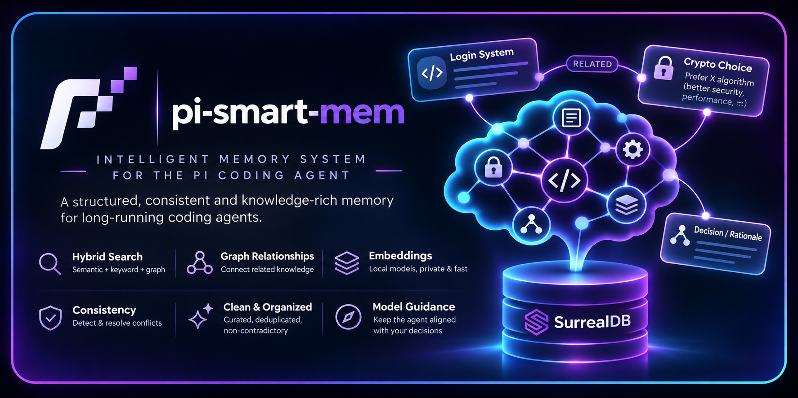
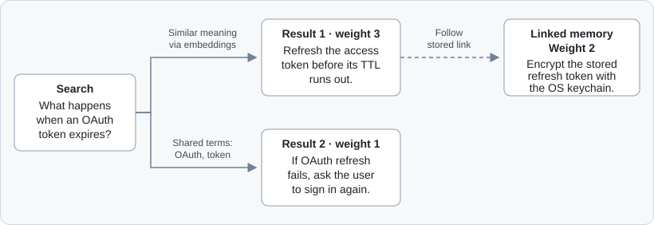

<div align="center">

# 🧠 Pi Smart Mem

**Persistent memory · Hybrid search · Session history**

</div>

---

Pick up where you left off in [Pi](https://pi.dev/) without explaining everything again. Smart Mem helps Pi remember how you work, what your project expects, and what didn't work last time.

- 🧠 **Memory across sessions** — Keep guidelines, preferences, and notes. Save them for one project or make them available across projects.

- 🔎 **Hybrid memory search** — Find exact error messages and identifiers with keyword search, or find the same idea in different words with local embeddings.

- 💬 **Search past conversations** — Look up what you discussed last week, even if it was never saved as a memory.

- 🔗 **Related memories** — Follow links between useful context that a search might not return together.

- ⚡ **Background review** — Pi reviews conversations for durable decisions, corrections, and lessons while you keep working.

- 📌 **Pins and reusable skills** — Keep standing instructions in view and save procedures you can use again.

- 🧹 **Memory maintenance** — Merge overlapping notes, resolve conflicts, and review how memories are classified.

- 💻 **Local storage and embeddings** — Keep the database and search on your machine. Embeddings run on CPU or compatible NVIDIA GPUs.

## What Smart Mem adds

- **Find by keyword, meaning, or relationship.** Embedded SurrealDB powers hybrid search and a memory graph. Keyword search finds exact terms, local embeddings find the same idea in different words, and graph links connect useful context even when the notes aren't similar. An OAuth note can link to how the tokens are encrypted.

- **Keep memories clean.** Smart Mem checks what's already saved before adding a memory. It can merge overlapping notes and clean up contradictions, so old and conflicting advice doesn't pile up.

- **Reinforce instead of duplicating.** When a fresh correction or verified recurrence confirms a lesson that's already saved, Smart Mem increases that memory's weight instead of adding another copy.

## Quick start

> <br>
>
> **Requirements:** Pi 1.5.2 or later and Node.js 22.19 or later.
>
> - **Linux / WSL:** `flock` from `util-linux` must be on your `PATH`.
> - **Windows:** No separate locking utility is required; the npm package installs the native dependency.
> - **macOS:** No separate locking utility is required; the npm package installs the native dependency.
>
> **Platform testing:** Tested on Linux and Windows. macOS is expected to work but hasn't been tested.
>
> <br>

<br>

1. Install Smart Mem from npm:

   ```sh
   pi install npm:pi-smart-mem
   ```

2. Start Pi (or run `/reload` if it's already open), then run `/psm-setup`.

3. Choose a CPU embedding model and confirm the download. The default MiniLM model is about 23 MB.

   **CPU setup needs no GPU, CUDA, or extra runtime installation.**

4. Once setup finishes, try asking Pi to remember a project convention or to find something you discussed in a past session.

   To make older Pi sessions searchable, use `/psm-settings` → **Transcript index** → **Backfill Pi sessions**.

### Optional: NVIDIA GPU embeddings

For GPU embeddings, set up an NVIDIA driver, CUDA 12, and cuDNN 9 for your OS. Make sure Smart Mem can load `onnxruntime-node` with the CUDA execution provider. It doesn't need to be installed in the Smart Mem profile.

Then run `/psm-setup` and choose a GPU embedding model. If you've already set up Smart Mem, use `/psm-settings` → **Embedding model** to switch.

> <div align="center">
>
> <br>
>
> **Migrating from Hermes?**
>
> Use `/psm-migrate-hermes` to import your data from `pi-hermes-memory`.
>
> <br>
>
> </div>

## Features

| Feature | What it does |
| --- | --- |
| 🧠&nbsp;**Persistent&nbsp;memory** | Keep guidelines, preferences, and lessons across sessions. Save them for one project or make them available across projects. |
| 🔎&nbsp;**Hybrid&nbsp;search** | Find memories by exact terms or by meaning, even when you don't remember the original wording. |
| 🎯&nbsp;**Auto&nbsp;recall** | Automatically brings relevant memories into the current conversation without loading everything you've saved. Use `/psm-inject` to bring in relevant context on demand. |
| 🔗&nbsp;**Memory&nbsp;links** | Connect notes that are useful together, even when they aren't similar enough to show up in the same search. |
| 💬&nbsp;**Session&nbsp;search** | Find details in past Pi conversations that were never saved as memories. |
| ⚡&nbsp;**Auto&nbsp;review** | Decides what's worth remembering, whether to add a new memory, update or reinforce an existing one, or skip it. For new memories, it chooses the kind and whether they belong to the project or should be available globally. |
| ⚙️&nbsp;**Review&nbsp;setup** | Choose which model reviews your conversations, how often it runs, and what instructions it follows when deciding what to save. |
| ⚖️&nbsp;**Weights** | Reinforce an existing memory when a fresh correction or verified recurrence confirms it, instead of saving another copy. |
| 🧹&nbsp;**Consolidation** | Merge overlapping memories so the same advice doesn't live in several places. |
| 🧩&nbsp;**Conflict&nbsp;cleanup** | Find and clean up contradictions between memories or with standing instructions. |
| 🧭&nbsp;**Priority&nbsp;rules** | Saved memories provide context, not authority. Your current request and applicable project instructions take precedence. |
| 📌&nbsp;**Pins** | Keep standing instructions available without relying on search to find them. |
| 📚&nbsp;**Reusable&nbsp;skills** | Pi can decide on its own to save a useful procedure as a skill so it can reuse what worked next time. |

## Make memory work your way

Smart Mem ships with default prompts, but you're not locked into them. In `/psm-settings` → **Model prompts**, you can change what Pi considers worth saving, how it classifies and reinforces memories, what it brings back into a conversation, and how it links, merges, or cleans up notes.

For example, you can ask Pi to save fewer routine details and focus on decisions, recurring mistakes, and project conventions. Edit the prompts that matter to you and leave the rest as-is. You can restore the defaults at any time.

In `/psm-settings` → **Trigger phrases**, you can also add correction phrases that start a background review or exclude phrases you don't want to trigger it. A phrase starts a review; it doesn't automatically save a memory.

## How it works

### Memory retrieval

**Automatic recall starts after 10 conversation messages by default**, counting both user and assistant messages. Change that number in `/psm-settings` → **Thresholds** → **Initial injection (messages)**. Pi uses the conversation so far to decide what to search for and adds only the memories it finds relevant. If none apply, it adds nothing. Use `/psm-inject` to run the same selection on demand.

**Search combines keywords and embeddings.** Smart Mem searches by both exact terms and meaning, then combines the results into one ranked list. By default it searches the current project's memories and global memories, not other projects' memories.

**Results include memory weights.** Pi is instructed to prefer higher weight when two memories are similarly relevant and applicable. A high weight doesn't make an unrelated memory relevant or override current instructions.

**Related memories are one hop away.** A stored graph link isn't the same as vector similarity. When Pi finds a useful memory, it can follow that memory's links to find related notes that didn't rank in the search. The link lookup returns directly connected memories; neither search nor automatic recall adds those neighbors by default. Pi has to look them up and decide which ones are useful.

#### Example search



Search returns results 1 and 2. If Pi follows the stored link from result 1, it also finds the note about encrypting the refresh token.

#### Pins: instructions that don't need retrieval

Pins are standing instructions you want Pi to see every time. Smart Mem adds all applicable pins to Pi's system prompt at the start of each run. They don't depend on search or the automatic recall threshold.

Use `/psm-pin <text>` for the current project, or `/psm-pin global <text>` to make the instruction available across projects. To remove a pin, open `/psm-settings` → **Pins**.

### How memories are saved

The **main agent** can save a memory directly during normal work. You don't have to ask it to remember something. Smart Mem also runs **background reviews** to catch useful information the main agent didn't save.

#### When a background review runs

- **When you correct Pi or ask it to remember something.** A recognized correction or a request such as "remember this" queues a review after the current run finishes.
- **Periodically.** By default, a review is due after **10 turns or 15 tool calls**, whichever comes first, once there's enough conversation to review.
- **Before compaction.** If the conversation has at least six user messages, Smart Mem captures the conversation before Pi shortens it. The review uses that captured context in the background while compaction proceeds, and can finish afterward.

In `/psm-settings`, use **Trigger phrases** to adjust which corrections start a review and **Thresholds** to change the periodic intervals and the pre-compaction review timeout. You can also choose a **Review model** or let reviews use the current session's model, and edit the review guidance under **Model prompts**.

#### How a review decides what to save

A trigger starts a review, not a save. The reviewer decides whether the information will be useful in later sessions, chooses the appropriate scope, and searches that scope before writing anything:

- **Add** a new memory if it captures something distinct and worth keeping.
- **Update** an existing memory if the conversation changes it or adds a lasting detail.
- **Reinforce** an existing memory if a fresh correction or verified recurrence confirms something already covered. This increases its weight instead of creating a duplicate.
- **Skip** if there's nothing durable to add or change and no new evidence to reinforce it.

For a new memory, the reviewer picks both a **scope** and a **kind**. Project scope keeps it with the current project; global scope makes it available across projects. A **guideline** is a standing rule you've given Pi, a **preference** is a default you favor, and a **note** captures other durable facts, decisions, or lessons.

### Memory maintenance

Linking connects distinct memories, consolidation combines overlapping ones, and conflict cleanup deals with memories that disagree.

#### Linking

`/psm-link` asks Pi to find memories that are useful together. For example, a note about OAuth token refresh can link to a separate note about how those tokens are stored securely. Pi considers all eligible pairs for the memories being checked, in batches if needed, rather than relying on vector similarity to decide which pairs it sees. Smart Mem saves each connection as a graph link between two memories, not as part of either memory's text. Pi can follow that link from one memory to the other during retrieval.

**Automatic linking** is off by default. Turn it on in `/psm-settings` → **Automatic linking**. Smart Mem then checks for links once a scope has **10 pending memories** by default. Change that number under **Thresholds** → **Automatic linking (pending memories)**.

#### Consolidation

`/psm-consolidate` looks for overlapping memories in the same scope. For each memory it checks, Smart Mem gives Pi up to eight similar notes to compare. Pi can merge notes that cover the same rule or answer the same question, or shorten a note that repeats itself. It keeps distinct details and conditions rather than merging notes just because they're about the same topic.

For example, "Run `npm test` before opening a PR" and "Check types with `npm run check` and run `npm test` before opening a PR" can become one note that keeps both checks.

Linking and consolidation check pending project memories by default. Add `global` to include global memories, `full` to recheck all project memories, or `global full` to recheck both scopes.

#### Conflict cleanup

`/psm-cleanup-conflicts` checks current-project and global memories in two passes:

1. **Against standing instructions.** Pi checks for direct contradictions with applicable instructions, such as an `AGENTS.md` rule. It removes the conflicting part and keeps unrelated information. It deletes a memory only if nothing durable remains.
2. **Against other memories.** Pi compares pending memories with up to eight similar notes in the same scope. It looks for advice that disagrees under the same conditions, not rules for different situations. When it resolves a conflict, it keeps unrelated details from the affected notes.

Run both passes together, or use `/psm-cleanup-conflicts guidance-only` or `/psm-cleanup-conflicts memory-only` to run just one.

#### Reclassification

`/psm-reclassify` is useful after importing memories from Hermes, which doesn't use Smart Mem's guideline, preference, and note categories. Pi reviews each imported memory's kind and changes it only when the evidence supports a different one. It doesn't rewrite the memory or move it between project and global scope. Run it in each imported project you want to review, and add `global` on one run to include global memories.

#### Direct database access

For a maintenance task the built-in commands don't cover, give Pi direct access to the Smart Mem database through `/psm-settings` → **Database access (this session)**. Choose **Read-only** to inspect data or **Read-write** if the task needs changes. Access is off by default and applies only to the current session.

> <br>
>
> **Working with memories**
>
> - **Edit or forget a memory directly.** Ask Pi to correct or remove a saved memory without running a maintenance pass.
> - **Search is local; model calls count toward usage.** Search and embedding generation run on your machine. Background reviews, automatic recall selection, and maintenance can make extra model calls that count toward your provider usage.
> - **Results depend on the model.** Reviews, classification, linking, consolidation, and conflict cleanup use model judgment. A model can miss an overlap or conflict, or make the wrong call. You can ask Pi to correct the result.
>
> <br>

### Reusable skills

A memory tells Pi **what to know**. A skill tells it **how to do something again**: the steps that worked, pitfalls to avoid, and how to verify the result.

Pi can save a skill on its own when it finds a repeatable workflow or you teach it one. Before saving, it looks for an existing skill it can reuse or improve. Skills can be project-specific or global, depending on where the procedure applies.

For example, a memory might say that a stale generated client causes a type error. A skill can capture how to regenerate the client, check the diff, and run the tests that verify the fix. Next time Pi sees that error, it can search for the skill and follow the procedure instead of working it out again.

### Session search

Use session search when you're trying to find something you discussed, not something Pi deliberately saved as a memory. Ask, for example, "What did we decide about the OAuth callback last week?" Pi can search past conversations for matching messages.

Search covers indexed conversations across projects by default and leaves out the current session. Pi can narrow it to a specific project or to messages you wrote.

Smart Mem indexes new conversations during normal use. To include older Pi chats, open `/psm-settings` → **Transcript index** → **Backfill Pi sessions**. You can also clear the search index from that menu without deleting the original transcripts.

## Storage and logs

Smart Mem keeps its files in `~/.pi/agent/pi-smart-mem/` by default. If you set `PI_CODING_AGENT_DIR`, look for `pi-smart-mem/` inside that directory instead.

| Path | What's stored there |
| --- | --- |
| `db/` | Embedded SurrealDB database: memories, graph links, pins, skills, and the searchable transcript index. Original Pi transcripts stay in Pi's `sessions/` directory. |
| `models/` | Downloaded embedding models used for local inference. |
| `settings.json` | Smart Mem settings, including your prompt overrides. |
| `smart-mem.log` | Activity, review outcomes, and errors. |

If you're tuning a prompt, turn on `/psm-settings` → **Debug logging** and run the relevant maintenance command again. For manual linking, consolidation, reclassification, and conflict cleanup, the log shows what the model evaluated and how it responded. Read it yourself or ask Pi to assess whether the decisions match what you intended. Debug logs can contain memory text and standing instructions, so review them before sharing.

## Contributing

Small fixes can go straight to a pull request. If your change affects what Smart Mem saves, recalls, or modifies automatically, open an issue first so we can agree on the intended behavior.

1. **Report the problem.** For a bug, include your OS, Pi and Smart Mem versions, what you expected, and steps to reproduce it. Remove private memory text, prompts, and credentials from any logs you share.
2. **Make and test the change.** Fork the repo and branch from `main`. Use a disposable Pi profile for tests, not your own memory database or session history.

   ```sh
   npm ci
   npm run check
   npm test
   ```

3. **Open a focused pull request.** Explain what changed, why, and how you tested it. For platform-specific changes, include which OS you tested.
